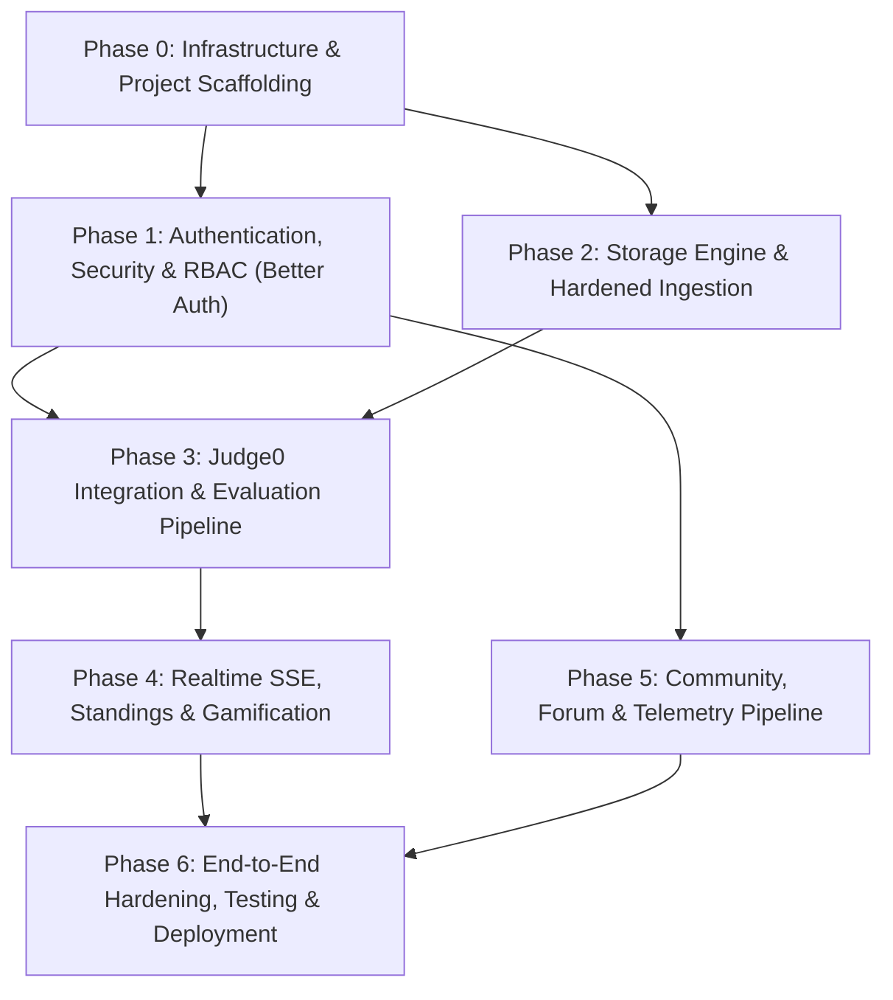

# Implementation Plan: Untitled Judge (NextGen Rewrite)

**Target Stack**: SvelteKit 2+ (Svelte 5 Runes) · Bun (v1.2+) · Prisma 8 · PostgreSQL 16+ · Redis 7+ · Judge0 CE (v1.13.1) · Better Auth (v1.7+)  
**Reference Document**: [PRD.md](./PRD.md) (v1.1.0-revised)  
**Execution Paradigm**: Phased, test-driven, modular architecture with continuous verification.

---

## 1. Architectural Overview & Dependency Graph



---

## 2. Phase-by-Phase Implementation Roadmap

---

### Phase 0: Infrastructure Setup & Project Scaffolding

#### 0.1 Objective
Establish the foundational local runtime, database containers, Redis message broker, Judge0 sandbox, and SvelteKit project skeleton with strict TypeScript configurations.

#### 0.2 Detailed Tasks & Deliverables

1. **Docker Compose Orchestration (`docker-compose.yml`)**:
   - **PostgreSQL 16**: Alpine-based, persistent data volume, custom health check.
   - **Redis 7**: Password-protected, append-only file (AOF) enabled, used for SSE event pub/sub and sliding window rate limiting.
   - **Judge0 CE v1.13.1**: Configured with `cgroups v2`, unprivileged isolate workers, isolated internal docker bridge (`judge0-net`), and internal shared secret token (`X-Judge0-Token`).
   - Create helper startup script: `scripts/dev-services.sh`.

2. **Project Initialization (Bun + SvelteKit 2 + Svelte 5)**:
   - Initialize project via Bun:
     ```bash
     bun create svelte@latest . --template skeleton --types ts --no-prettier --no-eslint
     ```
   - Install core dependencies:
     ```bash
     bun add @prisma/client@latest better-auth@latest nodemailer redis sharp isomorphic-dompurify marked zod
     bun add -D prisma@latest svelte-adapter-bun @types/nodemailer @types/isomorphic-dompurify
     ```
   - Configure SvelteKit to use Svelte 5 runes and Bun adapter (`svelte.config.js`).

3. **Prisma 8 Setup**:
   - Initialize `prisma/schema.prisma` with PostgreSQL provider as specified in [PRD.md](./PRD.md#4-prisma-8-database-schema-specification).
   - Configure Prisma Client singleton in `src/lib/server/prisma.ts`.
   - Run initial migration: `bun x prisma migrate dev --name init`.

4. **Directory Structure Organization**:
   ```text
   ├── docker-compose.yml
   ├── prisma/
   │   └── schema.prisma
   ├── storage/
   │   ├── testcases/         # Content-addressed (<sha256>.in, <sha256>.ans)
   │   ├── statements/        # Statement PDFs
   │   └── media/             # Re-encoded forum images & avatars
   ├── src/
   │   ├── hooks.server.ts
   │   ├── app.d.ts
   │   ├── lib/
   │   │   ├── auth-client.ts
   │   │   ├── server/
   │   │   │   ├── auth.ts
   │   │   │   ├── prisma.ts
   │   │   │   ├── redis.ts
   │   │   │   ├── judge/
   │   │   │   ├── storage/
   │   │   │   ├── telemetry/
   │   │   │   └── validators/
   │   │   └── components/
   │   └── routes/
   ```

#### 0.3 Definition of Done (DoD)
- `docker compose up -d` brings up PostgreSQL, Redis, and Judge0 in a healthy state.
- `bun run dev` boots the SvelteKit app cleanly.
- `prisma db execute --stdin` verifies tables are provisioned.

---

### Phase 1: Authentication, Security & User Management (Better Auth)

#### 1.1 Objective
Implement secure, production-grade authentication with email/password, 6-digit OTP confirmation, Google OAuth, and strict Role-Based Access Control (RBAC) without hand-rolled cryptography.

#### 1.2 Detailed Tasks & Deliverables

1. **Better Auth Configuration (`src/lib/server/auth.ts`)**:
   - Integrate Prisma adapter (`prismaAdapter(prisma, { provider: "postgresql" })`).
   - Configure `emailAndPassword` with Argon2id password hashing (minimum 64 MB memory cost, 3 iterations).
   - Configure `emailVerification` using Nodemailer SMTP transporter sending 6-digit one-time codes.
   - Configure Google OAuth 2.0 with encrypted access token persistence at rest.
   - Configure `admin` plugin with roles: `student`, `teacher`, `admin`.
   - Configure built-in rate limiter for auth endpoints.

2. **Server Hook & Security Headers (`src/hooks.server.ts`)**:
   - Session resolution binding `event.locals.user` and `event.locals.session`.
   - Forward auth routes `/api/auth/*` to `svelteKitHandler`.
   - Enforce HTTP headers:
     - `X-Content-Type-Options: nosniff`
     - `X-Frame-Options: DENY`
     - `Referrer-Policy: strict-origin-when-cross-origin`
     - `Permissions-Policy: camera=(), microphone=(), geolocation=()`
   - Configure nonce-based Content-Security-Policy (CSP) in `svelte.config.js`.

3. **RBAC Guard Utilities (`src/lib/server/rbac.ts`)**:
   - Create route-level authorization helpers: `requireAuth(event)`, `requireTeacher(event)`, `requireAdmin(event)`.

4. **User Profiles & Canonical Friendship Engine (`src/lib/server/friends.ts`)**:
   - Canonical ordering rule: `userAId < userBId` always enforced at database write.
   - APIs for sending, accepting, declining, and listing friendships.
   - Avatar upload pipeline: re-encode user images using `sharp` into WebP (max 512x512, stripping EXIF).

5. **Auth UI Components**:
   - Modal login/registration dialog using Svelte 5 Runes.
   - 6-digit OTP verification input with countdown timer and resend throttling.

#### 1.3 Definition of Done (DoD)
- User registration triggers an email containing a 6-digit OTP.
- Entering 5 invalid OTPs locks the verification token.
- Google OAuth logs in and provisions a `User` + `Account` row.
- Role-based route guards prevent `student` accounts from accessing `/admin/*`.
- Friend requests maintain canonical single-row representations without duplicates.

---

### Phase 2: Storage Engine & Hardened Problem Ingestion

#### 2.1 Objective
Build a content-addressed storage engine and hardened problem ingestion pipeline supporting DOMjudge directory synchronization, ZIP archive uploads with zip-slip mitigation, and sanitized statement rendering.

#### 2.2 Detailed Tasks & Deliverables

1. **Content-Addressed Storage Subsystem (`src/lib/server/storage/cas.ts`)**:
   - Content-addressing helper: computes SHA-256 hash of testcase content and writes to `storage/testcases/<sha256>.[in|ans]`.
   - Deduplication: identical test cases across different problems share disk blocks.
   - Generate truncated 2 KB preview for sample testcases to store in the database.

2. **DOMjudge Directory Scanner (`src/lib/server/storage/scanner.ts`)**:
   - Recursively walks a specified directory (e.g., `problems/`).
   - Parses `problem.yaml` (title, limits, float tolerance).
   - Parses `domjudge-problem.ini` (timelimit, color).
   - Reads `data/sample/` and `data/secret/` paired `.in` and `.ans` files.
   - Syncs problem metadata into the `Problem` and `TestCase` Prisma tables with zero binary BLOBs in PostgreSQL.

3. **Hardened ZIP Archive Ingestion (`src/lib/server/storage/zip-importer.ts`)**:
   - Enforce hard limits: compressed max 100 MB, uncompressed max 500 MB, max 1,000 files.
   - **Path Canonicalization**: Reject files containing `..`, absolute paths (`/`), or resolving outside the target staging directory (Zip-Slip defense).
   - **Symlink & Device Node Rejection**: Inspect file mode headers; reject any archive containing `S_IFLNK`, hard links, or FIFO/sockets.
   - Background ingestion worker with progress tracking.

4. **Problem Statement & Media Pipelines**:
   - Serve statement PDFs via streaming responses with inline disposition (`/api/problems/[id]/statement.pdf`).
   - Markdown statement rendering: parse with `marked`, sanitize with `isomorphic-dompurify`.
   - Prevent SVG uploads; process attached images through `sharp` to strip polyglot payloads.

#### 2.3 Definition of Done (DoD)
- Ingesting a standard DOMjudge problem folder imports all testcases and generates SHA-256 addressed files on disk.
- Uploading a malicious ZIP archive with `../../etc/passwd` or symlinks is immediately aborted with a `400 Bad Request`.
- No binary files larger than 4 KB exist in the PostgreSQL database.

---

### Phase 3: Judge0 Integration & Evaluation Pipeline

#### 3.1 Objective
Implement the sandboxed grading pipeline integrating Judge0 CE via internal VPC communication, HMAC-signed webhooks, compile-once optimizations, and custom output validators.

#### 3.2 Detailed Tasks & Deliverables

1. **Judge0 Client & Dispatcher (`src/lib/server/judge/client.ts`)**:
   - Language ID mapping (C17, C++20, Python 3.12, Java 21, Rust 1.80, Go 1.23).
   - Batch submission builder (`POST /submissions/batch?base64_encoded=true`) passing:
     - CPU limit, wall-clock limit, memory limit (512 MB), process limit (64), write limit (8 MB).
     - `enable_network: false`.
     - HMAC-signed callback URL.

2. **Compile-Once / Run-Many Optimization (`src/lib/server/judge/dispatcher.ts`)**:
   - For compiled languages with $>3$ test cases, package testcases together or mount them via `additional_files` to compile the executable once inside the sandbox.
   - For interpreted languages (Python) or $\le 3$ cases, utilize standard Judge0 batch requests.

3. **HMAC Webhook Verification (`src/routes/api/webhooks/judge0/+server.ts`)**:
   - Verify `sig = HMAC-SHA256(WEBHOOK_SECRET, subId + ":" + tcId)` using `crypto.timingSafeEqual`.
   - Parse execution status (Status IDs 1 through 14).
   - If testcase fails (`WA`, `TLE`, `RTE`), mark verdict and abort remaining cases if short-circuiting is enabled.

4. **Output Verification Engine (`src/lib/server/judge/validator.ts`)**:
   - **Token Normalizer**: Ignore whitespace differences (`\r\n` vs `\n`, trailing spaces).
   - **Float Tolerance**: Compare tokens with numerical parsing and absolute/relative tolerance $\le \epsilon$.
   - **Custom Validator Runner**: Execute problem's `output_validators` script inside Judge0 against `(input, answer, contestant_output)`.

5. **In-Browser Playground Runner (`src/routes/api/playground/run/+server.ts`)**:
   - Ephemeral code execution against sample cases or custom `stdin` (max 64 KB).
   - Route to lower-priority Judge0 queue with strict timeout (3.0s CPU / 5.0s wall) and 256 MB memory limit.
   - Per-user concurrency limit of 1 active playground run.

#### 3.3 Definition of Done (DoD)
- Submitting C++, Python, and Java code compiles and grades properly against multiple testcases.
- Webhook endpoints reject forged requests missing valid HMAC-SHA256 signatures with `401 Unauthorized`.
- Playground runs execute in $<800\text{ms}$ without inserting records into `Submission`.

---

### Phase 4: Real-Time Streaming, Standings & Gamification

#### 4.1 Objective
Deliver real-time submission progress updates via Redis Pub/Sub + SSE, idempotent one-time points scoring, materialized leaderboards, and Codeforces-style tier rankings.

#### 4.2 Detailed Tasks & Deliverables

1. **Redis Pub/Sub & SSE Stream (`src/routes/api/submissions/[id]/stream/+server.ts`)**:
   - Client opens SSE connection.
   - Server immediately emits initial snapshot from PostgreSQL to prevent race conditions.
   - Server subscribes to Redis channel `submission:<id>`.
   - Push real-time event packets: `{ step: "running", current: 3, total: 10 }` and final verdict.

2. **Idempotent Scoring Transaction (`src/lib/server/scoring.ts`)**:
   - Execute atomic PostgreSQL transaction upon `AC`:
     ```sql
     INSERT INTO "UserProblemPoints" ("userId", "problemId", "submissionId", "points")
     VALUES ($1, $2, $3, $4)
     ON CONFLICT ("userId", "problemId") DO NOTHING;
     ```
   - If points were awarded, atomically increment materialized counters `User.totalPoints` and `User.solvedCount`.
   - Update `UserProgress` state to `solved`.

3. **Points Formula & Tier Calculator (`src/lib/utils/gamification.ts`)**:
   - Module formula: $\min(1000, 100 + (\text{Module} - 1) \times 50 + \text{SetIndex} \times 25)$.
   - Tier badges: Newbie ($<300$), Pupil ($\ge 300$), Specialist ($\ge 800$), Expert ($\ge 1500$), Master ($\ge 2200$), Grandmaster ($\ge 3000$).

4. **Leaderboard & Standings Page (`src/routes/standings/+page.svelte`)**:
   - Query fast materialized columns (`totalPoints`, `solvedCount`) with pagination.
   - Filter by Collection / Module or toggle **Friends Only**.
   - Calculate user accuracy percentage ($\text{AC Submissions} / \text{Total Submissions} \times 100$).

#### 4.3 Definition of Done (DoD)
- Submission progress bar updates in real time on the frontend without HTTP polling.
- Repeated `AC` submissions for the same problem never increment points more than once.
- Leaderboard renders within 50ms under 10,000 simulated user records.

---

### Phase 5: Community, Discussion & Telemetry Pipeline

#### 5.1 Objective
Implement the classroom forum with moderation and sanitized image attachments, 1–5 star problem ratings, and a buffered non-blocking telemetry system.

#### 5.2 Detailed Tasks & Deliverables

1. **Classroom Forum (`src/routes/forum/+page.svelte`)**:
   - Categories: *General*, *Problem Help*, *Language Discussion*, *Study Group*.
   - Thread and reply creation with Markdown preview.
   - Image attachment upload: max 3 images (2 MB each), strictly raster formats, processed via `sharp`.
   - Soft-delete moderation for teachers and administrators.

2. **Problem Star Ratings (`src/routes/api/problems/[id]/rating/+server.ts`)**:
   - Allow 1-to-5 star ratings; verify that the user has at least one submission on that problem before allowing a rating.
   - Display aggregate rating and histogram on problem cards.

3. **Buffered Telemetry Subsystem (`src/lib/server/telemetry/buffer.ts`)**:
   - Record HTTP request latency, status codes, endpoints, and IPs into an in-memory ring buffer (or Redis list).
   - Flush bulk batches to PostgreSQL `HttpTrafficLog` every **10 seconds** using `prisma.httpTrafficLog.createMany()`.
   - Setup scheduled cron worker to prune raw traffic logs older than 14 days.

4. **Admin System Dashboard (`src/routes/admin/traffic/+page.svelte`)**:
   - Real-time 24h request chart (Success vs Error).
   - Top 10 visited endpoints and top visitor IPs.
   - Average response latency gauge ($p_{50}, p_{95}$).
   - Global announcement banner creation and toggling.

#### 5.3 Definition of Done (DoD)
- Forum threads render sanitized Markdown; SVG or script tags are stripped.
- HTTP traffic is logged in bulk without delaying user response times.
- Administrators can view live traffic and toggle site-wide announcements.

---

### Phase 6: End-to-End Hardening, Testing & Deployment

#### 6.1 Objective
Conduct end-to-end verification, security penetration testing, concurrency benchmarking, and configure production container deployment with Caddy reverse proxy.

#### 6.2 Detailed Tasks & Deliverables

1. **Security & Vulnerability Test Suite (`tests/security/`)**:
   - **Zip-Slip Test**: Attempt to import a ZIP containing `../../` path traversal.
   - **Webhook Forgery Test**: Attempt to POST forged Judge0 callbacks with bad signatures.
   - **XSS & Polyglot Test**: Attempt to post script tags and polyglot images in the forum.
   - **Resource Starvation Test**: Submit fork bomb and memory exhaustion code to verify sandbox enforcement.

2. **Concurrency & Load Testing (`tests/load/`)**:
   - Simulate 50 concurrent submissions from 25 users using `k6` or Bun load script.
   - Ensure zero dropped jobs, proper queue backpressure, and $<15\text{s}$ total completion time.

3. **Production Deployment Packaging**:
   - Multi-stage `Dockerfile` using `oven/bun:alpine`.
   - `docker-compose.prod.yml` provisioning Caddy, SvelteKit app, PostgreSQL, Redis, and Judge0.
   - Caddyfile with automated HTTPS, HTTP/3, and trusted proxy header forwarding.

#### 6.3 Definition of Done (DoD)
- All security test cases pass (exploits neutralized).
- Load test completes with 50 concurrent submissions with zero 500 errors.
- System starts cleanly with a single `docker compose -f docker-compose.prod.yml up -d`.

---

## 3. Implementation Risk Management

| Risk | Likelihood | Impact | Mitigation Strategy |
| :--- | :--- | :--- | :--- |
| **Judge0 Sandbox Misconfiguration** | Medium | High | Require `cgroups v2` verification script on host before booting; default `--share-net=false` and isolate process caps. |
| **Testcase Storage Exhaustion** | Low | High | SHA-256 content-addressing deduplicates identical files; enforce 100 MB compressed / 500 MB uncompressed limits on problem packages. |
| **Database Lock Contention on Standings** | Low | Medium | Materialize `User.totalPoints` and `User.solvedCount` directly on user row; read standings without runtime `SUM()` aggregates. |
| **SSE Connection Leaks** | Medium | Low | Ensure Redis pub/sub connections and SSE streams are closed on client disconnect (`request.signal.addEventListener("abort")`). |

---

## 4. Verification Checkpoints

```text
[ ] Checkpoint 1: Database & Services Boot (PostgreSQL 16, Redis 7, Judge0 CE healthy)
[ ] Checkpoint 2: Auth Verification (Email OTP & Google OAuth working with Better Auth)
[ ] Checkpoint 3: Ingestion Verification (DOMjudge directory scanned & ZIP uploaded cleanly)
[ ] Checkpoint 4: Execution Verification (Code compiles, runs in Judge0, and reports AC/WA/TLE)
[ ] Checkpoint 5: Realtime Verification (SSE streams progress packets without polling)
[ ] Checkpoint 6: Security Verification (HMAC webhooks verified, Zip-slip blocked, XSS sanitized)
[ ] Checkpoint 7: Full Load Test (50 simultaneous submissions graded successfully)
```

